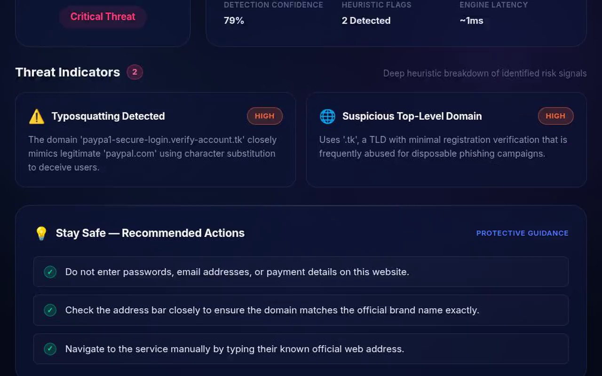

# PhishGuard AI

**Don't click. Verify.**

Paste a suspicious URL or message and get a threat score, the exact red flags found, and what to do next — in under a second.

Built for **NextSpark Hacks 2026** and **SafeSpace Hacks 2026**.

**Live demo:** https://dhanush-sai-reddy.github.io/phishguard-ai/



## What it does

- **URL scan** — typosquatting, raw-IP hosts, high-abuse TLDs, excessive subdomains, credential-harvesting paths
- **Message scan** — manufactured urgency, fake prizes, credential requests, authority impersonation, spam formatting
- **Threat score 0–100** with a consistent verdict band (Safe → Critical)
- **Explainable flags** — each signal states what was found and why it matters
- **Actionable tips** — what to do instead of just "dangerous"
- **Local scan history** — browser-only, clearable, never sent anywhere else
- **Demo mode** — works with zero API keys, fully offline after the first load

## Quick start

```bash
# 1. Frontend
npm install
npm run dev            # http://localhost:5173

# 2. Backend (second terminal)
cd server
npm install
cp .env.example .env   # optional: add OPENAI_API_KEY
npm run dev            # http://localhost:3001
```

The frontend proxies `/api` to port 3001. `npm run build` produces a static `dist/` that works without the backend (local fallback engine).

### Modes

| Mode | Trigger | Behavior |
|---|---|---|
| Demo | no `OPENAI_API_KEY` | Deterministic heuristic engine, no network |
| AI | `OPENAI_API_KEY` set | GPT analysis with the same response schema; falls back to heuristics on any API error |

The UI always shows which engine produced the result (`Demo Analysis` / `AI Neural Analysis`).

## Tests

```bash
cd server
npm test
```

Five API tests: mode detection, critical classification, deterministic scoring, safe-domain case, and input validation.

## How scoring works

Each signal contributes a fixed weight; the score is the maximum matched signal, not a sum, so one critical indicator is enough to raise the verdict. Identical input always produces an identical score — retry-safe for demos and judging.

| Band | Verdict |
|---|---|
| 0–20 | Safe |
| 21–40 | Low Risk |
| 41–60 | Suspicious |
| 61–80 | Dangerous |
| 81–100 | Critical Threat |

**Honest limits:** this is a transparent rules engine with an optional LLM layer, not a trained classifier. It does not fetch the URL, resolve DNS, or query threat feeds, so it cannot detect a compromised legitimate domain. "Detection confidence" is evidence coverage (how many weighted signals matched), not a statistical probability.

## Stack

- Vite + vanilla JS + hand-written CSS (no UI framework)
- Express + Node 18+
- OpenAI API (optional)
- In-memory rate limit: 20 requests/min/IP

## Project layout

```
index.html        markup and static sections
main.js           UI state, API calls, offline fallback, gauge, history
style.css         dark theme, responsive layout
server/index.js   /api/health, /api/analyze, heuristics, optional GPT
vite.config.js    dev proxy
```

## Privacy

No accounts. No database. No server-side storage of scanned content. History stays in `localStorage` and can be cleared from the UI.

## License

MIT
